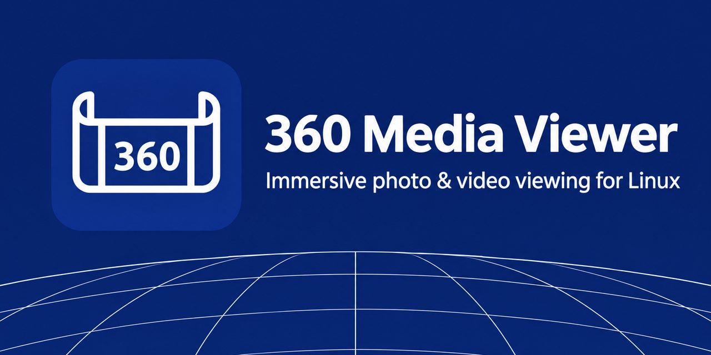

## Hello, this is 360 Media Viewer for Linux!
> At the moment, it is a strong word. Because at now it’s only for Debian-like distributions. But this is cool too, right? And over time, we will do porting for other popular Linux distributions.

## Modern Electron + React build
This project has been migrated from the legacy Vue 2 + Quasar + Electron 7 stack to a supported Electron + React + Vite configuration.

- Electron: 45.x
- Node.js: 20 LTS
- Renderer: React 18
- Build tool: Vite
- Packaging: electron-builder for Linux `.deb` and `.AppImage`

Local development:

```bash
npm install
npm run dev
```

Environment configuration:

```bash
cp .env.example .env
# optionally edit .env and set DEV_SERVER_PORT=5173
```

Supported variables:

- `DEV_SERVER_PORT` — base port for the Vite dev server. The app probes up to 5 ports starting at this value (for example `5173` to `5177` by default). Invalid values fail fast with a descriptive error.
- `SHT_VR_HOME` — optional override for the app data root. The application uses `<SHT_VR_HOME>/.sht-vr-player` as the storage root and falls back to `HOME`/`os.homedir()` when it is unset. The storage directory name remains unchanged to preserve existing user data.

The repo keeps `.env` and local variants ignored, while `.env.example` remains tracked and safe to commit.

## Build and install release artifacts

```bash
npm install
npm run electron:build
```

This builds the production renderer and packages both Linux artifacts in
`dist_electron/`:

- `*.deb`
- `*.AppImage`

Install a local Debian package with APT, which will resolve its declared
dependencies (including `ffmpeg`, `graphicsmagick`, and `perl`):

```bash
sudo apt install ./dist_electron/<package>.deb
```

Run the AppImage after marking it executable:

```bash
chmod +x dist_electron/<package>.AppImage
./dist_electron/<package>.AppImage
```

The AppImage is portable, but not universally dependency-free: some Linux
distributions require a compatible FUSE runtime to launch it. Install `perl`
and make it available in `PATH` for EXIF preservation; the bundled ExifTool
uses the system Perl runtime. Without it, imports requiring a derived image
and orientation correction fail with an error instead of saving without EXIF.
Media processing also requires `ffmpeg` and GraphicsMagick.

Use **Open folder** to replace the current library, or **Add files** to append
individual JPG, JPEG, PNG, INSP, and MP4 files. On Linux, installed desktop
integration also offers 360 Media Viewer in **Open With** for these formats.
Opening files in an already running instance appends them. A directory passed
alongside files replaces the library first, then the files are added.

The Debian package registers a private `image/x-360-media-viewer-insp` MIME
type for `.insp` files, because the system MIME database does not generally
define that extension. The AppImage includes the same MIME definition; making
it available to a desktop environment requires an AppImage integration tool.
Neither package makes the application the default file handler.

Maintainers planning Snap Store or repository-wide APT distribution should
follow [the distribution guide](docs/distribution.md). A local `.deb` is not
sufficient to make `apt install <package>` work on arbitrary machines.

## Releases and updates

When a pull request is merged into `main`, maintainers must apply exactly one
release label to create a release: `release:major` for incompatible changes,
`release:minor` for backwards-compatible functionality, or `release:patch`
for backwards-compatible fixes. Merges without exactly one of these labels do
not change the version. The versioning workflow creates the version commit,
tag, and changelog entry, then starts the release workflow. The release
workflow tests the tagged commit, builds `.deb` and `.AppImage` packages,
generates the Linux update metadata, and attaches only those release assets to
the matching GitHub Release.

Maintainers can also run **Manual SemVer release** from the Actions tab while
on `main`. They must explicitly select `major`, `minor`, or `patch`; the
workflow creates the same version commit, tag, changelog entry, and release
assets as the PR-label process.

The application checks published GitHub Releases when update checks are enabled.
It first offers **Download update**; downloading never restarts the application.
After the download completes, **Restart and install** requires separate explicit
confirmation. AppImage and `.deb` installations use the release metadata directly.
Installing a `.deb` update requires administrator authorization and a working
system package manager. This update path is intended until a hosted APT
repository is available. Auto-update requires a GitHub Release containing the
packages and its update metadata.

### Available npm scripts

- `npm run dev` — starts the Vite renderer and Electron app together. Electron starts after Vite is listening on port `5173`; both processes stop if either one exits.
- `npm run dev:renderer` — starts the Vite development server, listening on all network interfaces (`0.0.0.0`).
- `npm run dev:electron` — waits for the Vite server on port `5173`, then launches Electron.
- `npm run build` — builds the production renderer into `dist/`.
- `npm run preview` — serves the built renderer locally for preview. Run `npm run build` first.
- `npm test` — runs the Jest test suite serially.
- `npm run electron:build` — builds the renderer, then packages the app as the `.deb` and `.AppImage` targets configured in `electron-builder.json`.
- `npm run electron:dist` — alias for `npm run electron:build`; it always builds the renderer before creating both release artifacts.

## Why?
It's straightforward: I love 360 photos and videos, and I also like Linux. To view them, I had to switch to Windows, so I started developing this application. That is how **360 Media Viewer** began, and I hope it will be useful to you too.

## Where to download the 360 Media Viewer?
[https://viewer360.app/](https://viewer360.app/) or check the [release page](https://github.com/shturnev/ubuntu-360-player/releases)

## What can?
* Open a media directory or add individual media files and browse them in a thumbnail grid.
* View ordinary photos and videos as well as 360° photos and videos, including Insta360 `.insp` photos.
* Explore 360° media in an interactive panorama viewer, with a flat-view fallback.
* Correct panorama orientation with yaw, pitch, and roll controls; use center guides in Flat view and save the correction to the local cache.
* Navigate between media items, adjust thumbnail size, and select multiple items.
* Play MP4 video (H.264/HEVC) and convert incompatible videos to H.264 with progress reporting.
* View the original filename, EXIF, and other media metadata, including date, time, and location when available.
* Save a screenshot of a ready 360° panorama or export a copy of the current cached media.
* Preserve image EXIF metadata when creating derived cached images.
* Delete one or multiple media files, including from the full-size viewer.
* Inspect and clear the local media cache.
* Check, download, and install application updates for supported installations.
* Start the application with a media directory or multiple media files as command-line arguments, or use Linux Open With.

## Keyboard shortcuts

Shortcuts work when the application window is focused. Letter shortcuts use
physical key positions, so they also work with other keyboard layouts. They
do not trigger application actions while typing or when a conflicting dialog
is open. The browser defaults for `Ctrl+O`, `Ctrl+Shift+O`, `Ctrl+P`,
`Ctrl+S`, and `F1` are still suppressed in those contexts.

| Shortcut | Action |
| --- | --- |
| `Ctrl+O` | Open a folder for import. |
| `Ctrl+Shift+O` | Add media files to the current library. |
| `Ctrl+P` | Save a screenshot of the ready 360° panorama. Not available in Flat view or fallback. |
| `Ctrl+S` | Save a byte-for-byte copy of the current cached media file, which may differ from the original after conversion or orientation correction. |
| `F1` | Open Settings. |
| `I` | Show information about the current media; pauses video. |
| `O` | Toggle orientation correction for the current media. |
| `Space` | Play or pause video. |
| `Left` / `Right` | Show the previous / next media. |

The shortcuts are also listed in Settings and on the empty-library screen.

## What is planned?
- Support for other formats:
    - gopro

 

## How to help the project?
* The best way is to [**become a sponsor**](https://www.privat24.ua/send/krdrh) . I will be very grateful to you because it will allow me to focus on development, rather than finding food.

* If you are a designer, you can help with the visual design. Help is needed in the design of [https://viewer360.app/](https://viewer360.app/), and the interface in the application.

* The source code is available under the [Business Source License 1.1](LICENSE). The application is **free** for personal and commercial use on the terms in `LICENSE`. Contributors may create forks, issues, and pull requests to improve this project. Competitive production use is prohibited until the Change Date.
  

## Are you in touch?
Of course, you can always contact me at this email: **sergii@shturnev.com**

<p align="center">
  
</p>
